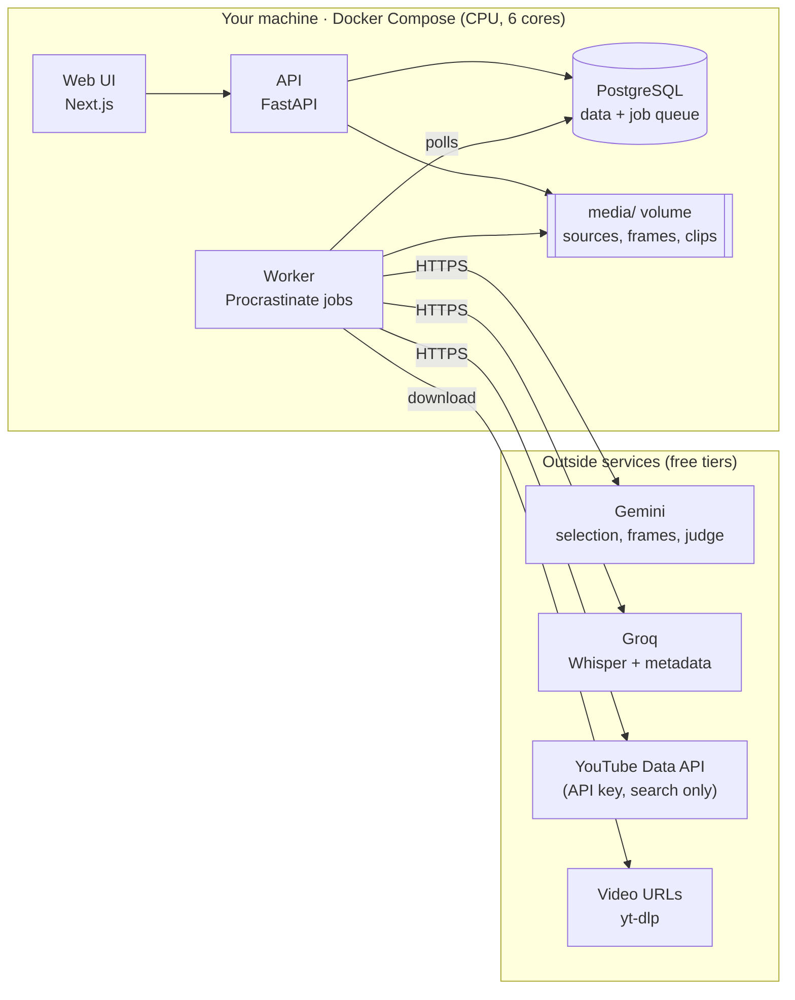
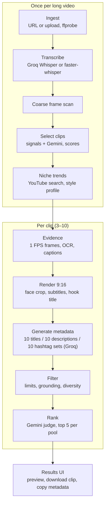

# ClipContext — Part 1 Requirements

_Last updated: 2026-10-22 · Owner: Vipul_

This file restates the Part 1 requirements as I understand them from our discussion. Decisions confirmed on 2026-10-22 are listed in section 10.

---

## 1. What Part 1 is

A **single-user, self-hosted tool** that takes **one long video (30 min to 2.5 h)** and produces **3–10 ranked vertical clips (9:16)**. Each clip comes with **publish-ready metadata**: titles, descriptions, hashtags and tags. Each metadata pool is ranked, and the top 5 are shown.

It is a **clean rebuild** inspired by SupoClip's design. No SupoClip code, prompts or assets are reused.

## 2. Decisions so far

| Topic | Decision |
|---|---|
| Build path | Clean rebuild of approach v2 (not a fork of SupoClip, which is AGPL-3.0) |
| Input | Long videos, 30 min – 2.5 h, from a URL (yt-dlp) or a file upload |
| Users | Single user, self-hosted (Docker Compose on one machine) |
| Hardware | CPU only, 6 cores |
| LLM providers | Gemini (free tier) and Groq (free tier) |
| Languages | English. Hinglish too, if the free tiers handle it (see section 6) |
| Target platforms | YouTube and Instagram. TikTok dropped for now |
| Moved to Part 2 | B-roll, built-in editor, account connection |
| ClipContext license | Not decided yet, so only permissive-license dependencies (MIT/BSD/Apache) are used |

## 3. In scope for Part 1

1. **Ingest**: add a video by URL or upload, validate it with ffprobe, extract audio.
2. **Transcription**: word-level timestamps, in English (and Hinglish if approved).
3. **Frame evidence**: a coarse frame scan of the whole video, then a 1 FPS scan, OCR and frame captions only inside the selected clips.
4. **AI clip selection**: deterministic signals plus an LLM pick of 3–10 clips. Each clip gets hook, engagement, value and shareability scores, plus a reason.
5. **Rendering**: face-tracked 9:16 crop, word-synced burned-in subtitles, and a hook title in the opening seconds.
6. **Niche trend mining**, once per long video: YouTube Data API search for the niche's top outlier videos, then a style profile built from them. This needs only an **API key**, not account connection.
7. **Metadata engine**, per clip: 10 titles, 10 descriptions and 10 hashtag/tag sets, each generated with a different strategy. They pass grounding, length and diversity filters, then an independent judge ranks them and the top 5 per pool are kept.
8. **Results UI**: the source page shows pipeline progress (polling). The clip grid shows each clip with a preview player, scores and ranked metadata. You can copy any metadata and download each rendered clip.
9. **Resumable jobs**: every stage is saved, so a crash or restart resumes from the failed stage.

## 4. Moved to Part 2

- B-roll (Pexels) and transitions.
- Built-in editor (trim, split, merge, caption edits).
- Account connection: OAuth for YouTube and Instagram.
- **Confirmed:** without account connection, Part 1 **cannot publish or schedule posts**, so **publishing** and the **performance loop** (which needs published posts' stats) also move to Part 2. Part 1 ends at *download clip + copy metadata*.
- TikTok (dropped for now).

## 5. Non-functional requirements

| Area | Requirement |
|---|---|
| Cost | Free: open-source libraries plus the Gemini and Groq free tiers. No paid APIs |
| Hardware | Must work on a 6-core CPU with no GPU. Slow is acceptable; failure is not |
| Video length | 30 min – 2.5 h per source video |
| Reliability | Stages are resumable and retried on free-tier rate limits (HTTP 429) with backoff |
| Privacy | Everything is stored locally. Only API calls leave the machine (LLMs, YouTube search, video download) |
| Licensing | Dependencies must be MIT/BSD/Apache or similar. **Do not use pyiqa** (PolyForm-Noncommercial) or Ultralytics (AGPL) |
| Progress | The UI polls job status. Real-time streaming is not required |

## 6. Languages: English and Hinglish on free tiers

**Short answer:** Hinglish looks feasible for **understanding and metadata generation** on the free tiers. **Hinglish subtitles** are the weak point and should be tested before committing.

- **Transcription.** Stock Whisper large-v3 handles Hindi but does poorly when asked for romanized Hinglish output. A Hinglish fine-tune reports about 29–32% word error rate where large-v3 gets about 51–62% on the same tests ([oriserve/whisper-hindi2hinglish-prime](https://huggingface.co/oriserve/whisper-hindi2hinglish-prime), Apache-2.0). That fine-tune is a 2B-parameter model, though, and would be very slow on a 6-core CPU for a 2.5 h video.
- **Free option.** Groq hosts Whisper large-v3 / large-v3-turbo on its free tier (reported 2,000 requests/day; check the exact audio-second limits in your Groq console). Audio is split into chunks to fit file-size limits.
- **LLM side.** Gemini and Groq models can read Hindi or Hinglish transcripts and write Hinglish titles and descriptions; no extra model is needed.
- **Plan:** English is the default. Hinglish is enabled after a test on 2 sample videos (one English-heavy, one Hindi-heavy) shows acceptable subtitle quality. If it fails, Part 1 ships English-only, as you instructed.

## 7. How the two LLMs are used

| Task | Provider | Why |
|---|---|---|
| Clip selection over the full transcript (up to 2.5 h) | **Gemini** (Flash, free tier) | Long context window holds the whole transcript in one call |
| Frame captions on selected frames | **Gemini** (Flash, free tier) | Multimodal |
| Metadata generation (per clip, short prompts) | **Groq** (free tier) | Fast, generous daily request count, short prompts fit its small per-minute token limit |
| Judge / ranking | **Gemini** | Different model family from the generator, which reduces self-preference bias |
| Transcription (if not local) | **Groq Whisper** | Free tier; much faster than CPU |

The LLM layer is Pydantic AI, with automatic retry and fallback between the two providers when a free-tier limit is hit.

## 8. Architecture

### Processing pipeline

### Component choices

| Component | Choice | License |
|---|---|---|
| API | FastAPI + Pydantic | MIT |
| Jobs + scheduling | Procrastinate on PostgreSQL (no Redis) | MIT |
| Database | PostgreSQL + Alembic | PostgreSQL / MIT |
| Download | yt-dlp | Unlicense |
| Media | ffmpeg / ffprobe + libass (system install) | LGPL/GPL by build |
| Local transcription fallback | faster-whisper (int8, CPU) | MIT |
| Shots | PySceneDetect | BSD-3 |
| Faces | OpenCV `FaceDetectorYN` + YuNet model | Apache-2.0 / MIT |
| Frame dedupe / diversity | imagehash + open_clip + MMR | BSD-2 / MIT |
| Frame quality | OpenCV blur, brightness, BRISQUE (`opencv-contrib`) | Apache-2.0 |
| OCR | RapidOCR (ONNX) | Apache-2.0 |
| LLM layer | Pydantic AI (Gemini, Groq) | MIT |
| Similarity / grounding | sentence-transformers, rapidfuzz, NLI checker | Apache-2.0 / MIT |
| Keyphrases | KeyBERT | MIT |
| Pairwise ranking | choix | MIT |
| YouTube search | google-api-python-client (API key) | Apache-2.0 |
| Frontend | Next.js + Tailwind + shadcn/ui | MIT |

## 9. Constraints to respect

- **YouTube search quota:** 100 `search.list` calls/day per Google Cloud project. Trend mining uses 2–3 per long video, so it is never run per clip.
- **YouTube data policy:** most API data can be stored for at most 30 days without a refresh. Outlier scores stay internal.
- **Gemini free tier:** limits change often, and free-tier prompts may be used by Google for training. Unreleased videos' frames go to Google. **Accepted for now.**
- **Groq free tier:** small per-minute token limits (reported 6K–12K tokens/min), so full transcripts go to Gemini, not Groq.
- **CPU:** heavy visual work (1 FPS, OCR, face tracking) runs only inside the selected clips, never on the whole 2.5 h video.

## 10. Confirmed decisions (2026-10-22)

- [x] Part 1 has no publishing or performance loop (account connection is Part 2).
- [x] Sending frames of unreleased videos to Gemini's free tier is OK for now.
- [x] Hinglish captions and metadata are written in Latin script.
- [ ] Hinglish quality test on 2 sample videos happens after Part 1 is built.

## 11. Sources

- [ClipContext Part 1 Architecture (doc)](https://claude.ai/artifact/GfkPAUiqo2q4nzUb6VuuLW)
- [SupoClip Study & Approach v2 (doc)](https://claude.ai/artifact/WxJGokzFf1YXrgPPbhgyEW)
- [ClipContext Research & Approach Options (doc)](https://claude.ai/artifact/FetkTnNP2CXzEh2vnuT4gA)
- [oriserve/whisper-hindi2hinglish-prime](https://huggingface.co/oriserve/whisper-hindi2hinglish-prime)
- [Groq free tier summary (developersdigest)](https://www.developersdigest.tech/models/free-api/groq)
- [Groq free tier limits (free-llm-api-resources)](https://mintlify.wiki/cheahjs/free-llm-api-resources/providers/free/groq)
- [Groq pricing and Whisper limits (morphllm)](https://www.morphllm.com/groq-pricing)
- [YouTube search.list reference](https://developers.google.com/youtube/data/reference/rest/v3/search/list)
- [Procrastinate docs](https://procrastinate.readthedocs.io)
